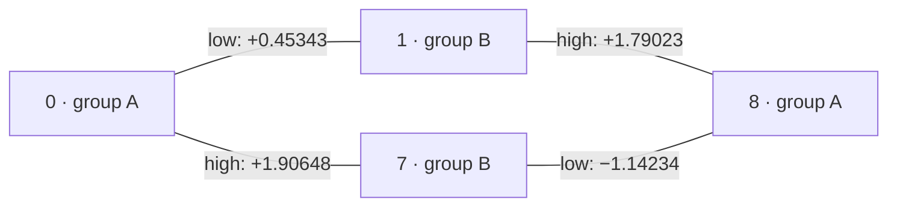

**Adversarial audit of the N71 controllability study**

The central controllability conclusions survive independent testing. The independently tested 2–16-state dimensions do not depend on tiny within-group matrix elements or a delicate rank cutoff. The important qualifications are the distinction between su(N) and u(N), between an RWA control model and an exact bandwidth constraint, and between finite-model reachability and useful experimental gates. The 48-state conclusion is supported by a verified sufficient theorem, not connectivity alone.

This audit preserves the original study. All new scripts and results are in this `audit/` directory. No eigenproblem, pulse propagation, pulse optimization, commit, or push was performed. In particular, neither a Stage-1 nor a Stage-2 eigensolve was run.

| Claim audited | Verdict | Finding |
|---|---|---|
| 1. The 2-, 4-, 6-, 11-, and 16-state pairs generate full su(N) | **CORRECT WITH QUALIFICATIONS** | All traceless dimensions independently reproduced. Literally retaining the trace of the supplied H0 gives **u(N)**. The original report already states this distinction correctly. |
| 2. Full controllability survives exact deletion of within-partition entries | **PASS** | Reconstructed the partition and explicitly zeroed its entire within-group blocks, including diagonals. Every requested rank is unchanged across five tolerances. |
| 3. The graph/frequency certificate establishes the 48-state result | **PASS** | Connected K24,24, nondegenerate energies, and distinct active transition frequencies independently verified. Exact rational comparisons of the stored binary64 energies verify the gap inequalities. The traceless stored-matrix algebra is su(48). |
| 4. Outer-only control disconnects logical sectors; adding the low band restores four-state control | **CORRECT WITH QUALIFICATIONS** | An independently constructed physical rotating-frame RWA gives dimensions 7 and 15, respectively. This requires the specified programmable envelope controls; it is not a theorem about an unspecified hard bandwidth or a fixed few-parameter pulse. |
| 5. The empirical bipartition is not an abstract controllability obstruction | **PASS** | It grades interaction order but is not a conserved symmetry of the driven Hamiltonian. Frequency restrictions change the available effective generators. |
| Stability at the actual N51→N71 shift scale | **CORRECT WITH QUALIFICATIONS** | Original tests covered only ±1 MHz. New tests use the recorded shifts, reaching 40.39 MHz, and retain full ranks. They are finite structural tests with the N71 control matrix fixed, not a guarantee for all refinements. |
| Original report's linked workspace-verification artifact exists | **FAIL — documentation only** | `../workspace_verification.json` is absent. This audit supplies its own preservation check; the original link should be corrected explicitly in a future authorized edit. |

**Data and conventions.** The independent loader verifies the checkpoint completion marker, configuration fingerprint, checkpoint hash, and all payload hashes. It checks the preceding reconstruction's provenance against those hashes, low-11 energies and magnitudes against checkpoint analysis, and the signed low-11 entries against the saved signed CSV. The reused signed NPZ SHA-256 is `4e773bb3ce23d7bc2191b964f05ac656087ecc6377ff251f1e5fa4bf0697e010`. Low-11 energy disagreement is 1.812×10⁻¹³ GHz, magnitude disagreement 4.832×10⁻¹², and signed CSV disagreement is zero. Non-Hermiticity of 8.521×10⁻¹⁵ is symmetrized. See [authentication.json](authentication.json).

Authentication here accepts the already derived 48-state signed NPZ and its saved provenance. It does not independently reconstruct those eigenvectors or their matrix elements from the checkpoint. Recording a derived-file hash alone is not an independent physical reconstruction. No signs are inferred from absolute values; all control calculations use the signed data.

Write D=H0/h in GHz, Φ=`grid_phi`, time in ns, and evolution as dU/dt=−i2π(D+uΦ)U. The common factor and generator sign do not change the real Lie span. Trace removal discards global phase only. Each calculation explicitly extracts both rows and columns for its stated state list; no larger matrix is accidentally commuted inside a smaller calculation.

**Code audit of every original script.** All six Python scripts were inspected; none was executed or imported by this audit. The independent checker imports NumPy/SciPy and its companion imports only the checker in this directory.

| Original script | Inspection result |
|---|---|
| `algebra.py` | Correct real Lie-space convention, signed inputs, ordered truncation, trace removal, and orthogonalization. Its Hermitian bracket i[A,B] is isomorphic under H↦iH to the ordinary skew-Hermitian commutator. The diagonal coordinates and √2-scaled real/imaginary off-diagonals are Frobenius-orthonormal traceless coordinates. Two projection passes remove dependence; inverse coordinates preserve the required matrix structure. |
| `closure48.py` | Correct invocation of the original closure, at tolerance 10⁻⁹ after setting small entries to zero. It is a **floating-point closure**, not an exact symbolic proof. Its minimum admitted residual is 1.04286×10⁻⁹, close to the cutoff. The tiny residual after reaching the complete ambient span is not independent evidence of correct admission of every direction. The separately verified theorem is decisive. |
| `minimal.py` | Correct empirical grading, zero one-auxiliary products, and absence of second-order coupling through diagonal resolvents in the exactly cleaned matrix. Counterfactual degeneracy tests are labeled. Its path count is a graph count, not a pulse-rate calculation. |
| `restricted.py` | Signed weights and `(0,1,7,8)` ordering are correct. Two-band rotating drifts, residual detunings, and quadrature generators are consistent. The first high-only/low-only rows use laboratory-drift edge masks, as the report acknowledges. This audit adds actual single-band rotating-frame calculations. Shelving and nested-commutator identities reproduce exactly. |
| `stability.py` | Correct finite ±1 MHz tests and sufficient pair-gap margin calculation. These tests did not establish stability at the larger recorded spatial-convergence shifts; this audit supplies that missing scale. |
| `plots.py` | Correct displayed graph, signs, and matrix ordering. Its dimension arrays are hard-coded, so figures are illustrations, not additional verification. The independent results confirm those plotted values. Future regeneration should read result files instead. |

The original closure starts with Frobenius-normalized traceless seeds, then adds independent commutators of every accepted direction with each original seed. Iterated seed adjoints suffice by Jacobi: their invariant span contains every Lie word. All-pairs commutation is unnecessary. Duplicate, reversed, and zero commutators are removed by projection. It stops at N²−1 or exhaustion, checks orthogonality, and checks invariance under seed adjoints. No convention, sign, or state-index error was found. Its `bracket_count` is a loop-derived count and can overcount the final partially completed generator loop; that bookkeeping does not affect the dimension.

Two evidentiary cautions matter: a complete orthonormal basis of the imposed traceless ambient space necessarily has tiny final closure residual; and a list of the canonical N²−1 su(N) basis elements is not by itself proof that the supplied generators produce them. The original graph/frequency argument supplies the missing reachability connection, and the independent rank calculation below provides a separate numerical route.

**Independent closure algorithm and classification.** [independent.py](independent.py) uses actual complex anti-Hermitian matrices and the ordinary commutator AB−BA. Its real Frobenius basis consists of real antisymmetric off-diagonal matrices, imaginary symmetric off-diagonal matrices, and imaginary diagonal matrices. For the traceless run, QR of consecutive diagonal differences supplies the diagonal trace complement. This differs from the original explicit coordinate formula.

Each round forms a whole block of seed-adjoint commutators, projects twice against the existing space, and uses an SVD to admit singular directions above an absolute tolerance. Seeds have unit Frobenius norm; basis directions are orthonormal. Accepted blocks are joined by QR. The loop stops when no new singular direction remains, rather than declaring success on reaching a requested dimension. The resulting matrices are also checked in redundant real/imaginary coordinates without suppressing the identity, allowing the rank immediately outside the claimed algebra to be inspected. Nonzero trace is separately retained in u(N) runs.

Negative controls at 10⁻⁸, 10⁻¹⁰, and 10⁻¹² return the proper algebras: spin-3/2 su(2), dimension 3; proper sp(2) on four states, dimension 10; so(3), dimension 3; and two disconnected pairs with relative phase, dimension 7. Complex diagonal gauge changes and state permutations preserve the N=4,6,11 answers. These checks test complex vectorization and prevent interpreting an algorithm that always fills its ambient space as a valid closure.

| State set | N | Traceless algebra and dimension | Trace retained | Empirical cleaned graph |
|---|---:|---|---|---|
| `{0,1}` | 2 | su(2), **3** | u(2), **4** | K1,1 |
| `{0,1,7,8}` | 4 | su(4), **15** | u(4), **16** | K2,2 |
| `{0,1,2,3,7,8}` | 6 | su(6), **35** | u(6), **36** | K3,3 |
| `0..10` | 11 | su(11), **120** | u(11), **121** | K6,5 |
| `0..10 ∪ {26,28,29,31,32}` | 16 | su(16), **255** | u(16), **256** | K8,8 |

The full traceless span identifies su(N), not just an algebra with a suggestive dimension. No proper orthogonal or symplectic restriction survives. As another check, the normalized skew generators were tested for an invariant complex bilinear form S satisfying AᵀS+SA=0. Its nullity is zero for N=4,6,11,16, excluding conjugate defining so/sp representations. At N=2 the nullity is one, an antisymmetric form, consistent with su(2)=sp(1). The smallest constraint singular values for N=4,6,11,16 are 0.1685, 0.1760, 0.08754, and 0.08688. See [invariant_form_checks.json](invariant_form_checks.json).

Because D is nondegenerate, any matrix commuting with D is diagonal. A nonzero Φij requires equal diagonal commutant entries at i and j. Each connected graph therefore has only scalar common commutant, of complex dimension one. There is no proper common invariant Hilbert subspace. This argument alone would establish irreducibility, not full su(N); the rank/certificate arguments are additionally needed.

**Tolerance stress test.** Each entry below is `stored / exactly bipartite`, with the entire within-group blocks set to zero in the latter. Every one of the 50 traceless calculations agrees. The five untraced calculations give the u(N) dimensions above.

| N | 10⁻⁸ | 10⁻⁹ | 10⁻¹⁰ | 10⁻¹¹ | 10⁻¹² |
|---:|---:|---:|---:|---:|---:|
| 2 | 3 / 3 | 3 / 3 | 3 / 3 | 3 / 3 | 3 / 3 |
| 4 | 15 / 15 | 15 / 15 | 15 / 15 | 15 / 15 | 15 / 15 |
| 6 | 35 / 35 | 35 / 35 | 35 / 35 | 35 / 35 | 35 / 35 |
| 11 | 120 / 120 | 120 / 120 | 120 / 120 | 120 / 120 | 120 / 120 |
| 16 | 255 / 255 | 255 / 255 | 255 / 255 | 255 / 255 | 255 / 255 |

The following gaps are from the exactly bipartite run at 10⁻¹⁰. Stored-matrix results agree at the shown precision. “Last growth” refers to the projected block that adds the final missing directions, before the space is complete. This is more informative about admission than a final residual after completion.

| N | Weakest admitted singular value over growth | Last-growth smallest retained | Last-growth largest rejected | Final matrix-span σd / σd+1, d=N²−1 |
|---:|---:|---:|---:|---:|
| 2 | 2.000 | 2.000 | 0 | 1.73205 / 2.67×10⁻¹⁶ |
| 4 | 0.0046334 | 0.724845 | 1.20×10⁻¹⁶ | 1.000398 / 4.36×10⁻¹⁶ |
| 6 | 0.0369714 | 0.343590 | 4.85×10⁻¹⁷ | 1.000815 / 6.00×10⁻¹⁶ |
| 11 | 0.0052146 | 0.205896 | 1.30×10⁻¹⁶ | 1.000629 / 2.35×10⁻¹⁵ |
| 16 | 0.0132001 | 0.0641264 | 5.55×10⁻¹⁶ | 1.000957 / 3.12×10⁻¹⁵ |

The final matrix-span block contains the orthonormal generated basis and its seed commutators; its O(1) retained singular values are partly a consequence of that normalization. These numbers are numerical rank diagnostics, not physical control strengths, condition numbers of a pulse-synthesis problem, or error margins on circuit parameters. Across these runs the maximum orthonormality error is 1.88×10⁻¹⁴ and the largest traceless-basis trace is 7.78×10⁻¹⁶. [Full round-by-round results](independent_closures.json), [tolerance table](tolerance_results.csv), and [negative controls](negative_controls.json) are saved.

**Bipartition and interaction order.** Graph reconstruction reproduces A=`{0,2,4,6,8,9}` and B=`{1,3,5,7,10}` in the low 11. All 30 cross-group entries are appreciable; the weakest is 0.00479624. In all 48 states the groups have 24 members each, with 576 cross edges and minimum magnitude 0.000266237. The largest removed within-group entry is 1.78365×10⁻¹¹; its full-48 operator norm is 3.23377×10⁻¹¹. Every retained cross-group entry is much larger than the removed entries. Explicit within-block zeroing equals the original 10⁻⁸ threshold cleaning for these data. [Partition](partition.json).

For J=+I on A and −I on B, [J,D]=0 and JΦJ=−Φ in the cleaned model, but J(D+uΦ)J=D−uΦ. J relates opposite waveforms; it does not conserve a sector at nonzero control. No physical parity label is justified by this numerical observation alone.

In the drift interaction picture each control insertion is J-odd. Opposite-group logical states therefore require an odd number of Φ insertions; even-order logical off-diagonal terms vanish. First-order direct driving is allowed, and the shortest indirect graph path has three edges. Every product Φ0aΦa1 is exactly zero in the cleaned model, so one common auxiliary cannot form a second-order bridge. Three steps do not require three distinct carrier frequencies. The rule is approximate for the raw tiny within-group entries and is not guaranteed under a refinement that changes the zero pattern.

**Four-state matrices, graph, and restricted models.** In order `(0,1,7,8)`, the independently read matrices are

\[
D=\operatorname{diag}(0,0.015857269552161,6.275014070727282,6.297747507784917)\quad\mathrm{GHz},
\]
\[
\Phi_{\rm odd}=\begin{pmatrix}
0&0.453425489024&1.906482087463&0\\
0.453425489024&0&0&1.790232028822\\
1.906482087463&0&0&-1.142340320045\\
0&1.790232028822&-1.142340320045&0
\end{pmatrix}.
\]

The zeros here are explicitly cleaned. [four_state_matrices.json](four_state_matrices.json) includes the raw tiny entries as well.

| Edge | Signed Φij | Transition MHz | Collective band |
|---|---:|---:|---|
| 0–7 | +1.906482087 | 6275.014071 | High |
| 1–8 | +1.790232029 | 6281.890238 | High |
| 0–1 | +0.453425489 | 15.857270 | Low |
| 7–8 | −1.142340320 | 22.733437 | Low |



Let Xij=|i⟩⟨j|+|j⟩⟨i|, Yij=−i|i⟩⟨j|+i|j⟩⟨i|, and define BH=aX07+bX18 and BL=cX01+dX78 using the table's signed weights. A real high/low cosine waveform gives these collective generators after the corresponding RWA, with factors 1/2 absorbed into envelope definitions. Phase control provides the corresponding Y sums. It does not independently address the individual close edges.

Choose νH=6278.452154 MHz. In the **high-only physical rotating frame**, rotating frequencies are `(0,0,νH,νH)`, giving

\[
D_H=\operatorname{diag}(0,15.857270,-3.438084,19.295353)\quad\mathrm{MHz}.
\]

The projectors onto `{0,7}` and `{1,8}` commute with DH and both high-band quadratures exactly. Thus logical transfer is impossible in this first-order effective model. The algebra is s(u(2)⊕u(2)), dimension 7, including a relative block-phase direction. Unequal squared weights a²−b²=0.429743 allow separation of the two pair algebras through nested commutators despite their equal-magnitude rotating detunings. Both fixed-phase amplitude control and I/Q give the same dimension here.

Add νL=19.295353 MHz and rotating frequencies `(0,νL,νH,νH+νL)`. The drift becomes

\[
D_{HL}=\operatorname{diag}(0,-3.438084,-3.438084,0)\quad\mathrm{MHz}.
\]

For independent signed real envelopes multiplying BH and BL, the Lie dimension is 15; I/Q also gives 15. The residual drift supplies noncommuting quadratures. Together with unequal weights within each collective pair, their nested commutators isolate the edges, whose connected graph supplies su(4). Alternatively, with I/Q available, commuting a weighted X sum with its Y sum and again with a quadrature produces linear combinations weighted by a,b and a³,b³; a²≠b² permits their separation. The low group similarly has c²−d²=−1.099347.

| Independently checked model | Dimension | Classification |
|---|---:|---|
| Full physical D, Φ | 15 | su(4) |
| High-only physical RWA, fixed phase or I/Q | 7 | s(u(2)⊕u(2)); logical states in different sectors |
| Low-only physical RWA, fixed phase | 7 | s(u(2)⊕u(2)); logical pair itself controllable |
| Two-band RWA with actual residual drift, fixed phases or I/Q | 15 | su(4) |
| Shelving carrier νL=f78, actual residual drift, fixed phases or I/Q | 15 | su(4) |
| Counterfactual zero residual drift, two fixed-phase envelopes | 6 | A conjugate of so(4) |
| Counterfactual zero residual drift, I/Q envelopes | 15 | su(4) |
| Physical D with exact outer-pair frequency coincidence, Φ retained | 15 | su(4) |
| Physical D with Φ01 explicitly removed, primary chain retained | 15 | su(4) |

Each row was checked at 10⁻⁸, 10⁻¹⁰, and 10⁻¹². The so(4) counterexample is also verified by applying phase i to one empirical group, which converts the two zero-drift skew generators into real antisymmetric matrices. This demonstrates why dropping the residual drift can change the answer. [Restricted results](restricted_results.json).

These are statements about specified effective generators. A finite-duration pulse is not exactly band limited; strict spectral support, limited envelopes, fixed phases, finite amplitudes, and fixed gate time define different constrained problems. Retaining only first-order resonant edges is not an exact replacement for the physical Φ. The GHz-only RWA sector result therefore does not forbid every multiphoton/off-resonant process in the full cosine Hamiltonian. Likewise, full RWA rank with arbitrary envelopes does not prove that one fixed two-tone pulse implements every gate. Counter-rotating low-band terms oscillate at only roughly 39–45 MHz, so validity for the 70 ns strong-drive example is not established by this Lie analysis.

**48-state certificate and what counts as proof.** The relevant sufficient condition is connected control graph plus nonzero, distinct transition frequencies on every active edge, for a diagonal drift in the closed finite-dimensional bilinear control model. This is the B-regular connected-graph condition of [Altafini, Theorem 3](https://arxiv.org/pdf/quant-ph/0110147); connectivity alone is insufficient.

The independent certificate gives:

| Quantity, all 48 stored states | Result |
|---|---:|
| Cleaned graph | Connected K24,24, 576 edges |
| Minimum level separation | 5.323414815 MHz |
| Minimum active-edge magnitude | 0.000266236868 |
| Minimum separation of active transition frequencies | **37.863340955 kHz** |
| Closest active-frequency pairs | 14–43 and 12–39 |
| Minimum separation among all 1128 pair frequencies | **3.107608336 kHz** |
| Closest all-pair frequencies | 29–39 and 24–29 |
| Traceless conclusion | **su(48), dimension 2303** |
| Trace retained | **u(48), dimension 2304** |

[independent_certificates.json](independent_certificates.json) uses `Fraction(float_energy)` to compare binary64 energies as exact rational values. Thus no rounded subtraction or tolerance decides whether these gap differences are zero. Positive active weights and a connected graph were also checked. All-pair regularity additionally covers the raw matrix with its small extra entries; a certificate for the cleaned graph alone would not automatically establish that stronger raw-matrix statement.

For completeness, our edge-isolation construction is: set A=iD and T=ad(A)². Each edge iXij has eigenvalue λij=−(Ei−Ej)². The polynomial

\[
p_e(T)=\frac{T}{\lambda_e}\prod_{f\ne e}\frac{T-\lambda_f}{\lambda_e-\lambda_f}
\]

annihilates the diagonal and every other active edge, leaving the nonzero edge coefficient times iXij. A further drift commutator gives its other quadrature; their commutator gives the diagonal difference. Commutators along connected paths then give all pair quadratures and N−1 diagonal differences. This establishes N²−1 independent directions without numerically evaluating an ill-conditioned high-degree polynomial.

Accordingly, the evidence is an **analytic sufficient-theorem proof for the stored numerical matrix**, with exact checking of the energy inequalities. It is stronger than a heuristic graph argument. It is not an interval proof for uncertain physical energies, a proof of physical-model convergence, or an independent new numerical 48-state closure. This audit did not rerun a 48-state closure; the saved closure was inspected and is corroborative. Its near-cutoff admitted residual should be stated whenever it is presented as numerical evidence.

**Stability at measured refinement scales.** Stored overlap tracking matches N51 states 0..10 to N71 states 0..10 without reordering; every assignment is marked safe, with minimum overlap 0.9987496. The recorded ground-referenced shifts are:

| State | N71−N51 shift, MHz |
|---:|---:|
| 1 | −0.203700 |
| 2 | −4.210339 |
| 3 | −4.815887 |
| 4 | −18.633745 |
| 5 | −22.442489 |
| 6 | −3.415212 |
| 7 | −3.843656 |
| 8 | −6.200250 |
| 9 | −40.390556 |
| 10 | −7.111396 |

Using the N71 signed Φ throughout, 72 additional independent closures all give full su(N):

| Stress test | Number | Result |
|---|---:|---|
| N71 energies plus λ times the observed shift, λ=−1,−1/2,+1, for N=2,4,6,11 | 12 | All full su(N) |
| Independent ±1 Hz energy perturbations before subtracting the common ground shift, four draws per tested size | 20 | All full su(N); relative shifts at most 2 Hz |
| Independent shifts scaled to each state's recorded shift magnitude, four draws per tested size | 20 | All full su(N) |
| Raw-entry cutoffs 10⁻¹², 10⁻¹¹, 10⁻¹⁰, 10⁻⁸, for each tested size | 20 | All full su(N) |

The weakest admitted singular direction across these stress closures is 0.002932. All also satisfy the independent frequency certificate. For the extra five states of the 16-state set, no matched N51 shifts were available in this analysis: their synthetic shifts use ±40.3906 MHz, explicitly the largest observed low-11 shift scale, not an asserted measured high-state shift. Eight similarly scaled synthetic 48-state perturbations pass the graph/frequency certificate; those are certificate checks rather than numerical closures. The exact sampled shifts are saved in [stability_results.json](stability_results.json) and [stability48_certificates.json](stability48_certificates.json).

These results strengthen the original structural stability evidence. They do not verify a simultaneous physical change of eigenvectors, couplings, omitted modes, or truncation error. Using N51 energies with N71 Φ is a controlled frequency-sensitivity test, not a reconstruction of the N51 Hamiltonian.

Full Lie rank is open under sufficiently small matrix perturbations, since a finite nonzero commutator determinant remains nonzero locally. A conservative frequency-only guarantee follows because changing each energy by at most η changes a difference of transition frequencies by at most 4η. Keeping Φ fixed, η<1.71904 MHz preserves the four-state certificate; for 48 states the active-edge and all-pair sufficient bounds are respectively 9.46584 kHz and 0.776902 kHz. These small 48-state bounds preserve a particular nondegeneracy certificate; crossing them is not a predicted loss of controllability. The larger sampled shifts remain full rank because no exact obstructing symmetry or degeneracy is introduced. No uniform 40 MHz robustness region has been proved.

**Scientific interpretation and minimum structure.**

1. **Arbitrary logical SU(2) is reachable in the current finite model under unrestricted scalar control.** For a coherent closed system, variable signed control values, and unconstrained final time, full su(N) permits Vlogical⊕Iaux for every Vlogical∈SU(2). This is full relative-phase control, not just state transfer. The untraced central generator adds global phase. It is not a fixed-time or fixed-bandwidth claim.

2. **The two-state projection already suffices algebraically.** Its nonzero Φ01 gives X, the drift commutator gives Y, and the next commutator gives Z. With Z=|0⟩⟨0|−|1⟩⟨1| and C(A,B)=i[A,B], DL=−f01 Z/2 and ΦL=φX give C(DL,ΦL)=f01φY and C(ΦL,C(DL,ΦL))=−2f01φ²Z. No auxiliary or third tone is fundamentally necessary in this abstract sense. Idle evolution supplies Z; its relative π phase time is about 31.53 ns, which is not a lower bound for X gates.

3. **A projected minimum is not an invariant physical manifold.** QΦP has rank two in every enlarged tested set; in the four-state core its singular values are 1.90648 and 1.79023. Requiring the entire bare logical subspace to remain invariant at every instant forces uQΦP=0 and hence u=0. Nontrivial X control cannot have identically zero transient leakage for all inputs, although leakage-free final targets are abstractly reachable. All 48 saved states form the smallest invariant manifold of that stored pair. Larger models can add further leakage.

4. **Four states suffice for shelving the whole qubit into a disjoint auxiliary space.** Unitarity requires two orthogonal auxiliary images for two logical inputs. For a phase-matched swap S exchanging `(0,1)` with `(7,8)`, S†(VL⊕VA)S=VA⊕VL. This identity was independently verified with zero numerical residual. Thus the low tone can act on the empty original logical pair during ideal shelving without spoiling the transported auxiliary rotation. The mechanism is general; the reported 70 ns overlap, pulse calibration, and nearly complete transient leakage are specific numerical outcomes. This audit did not reproduce those dynamics, and Lie rank does not validate their fidelity.

5. **Three-tone control is not fundamentally required.** The unrestricted scalar pair is already full; the specified two-band RWA with independently variable envelopes is also full. Fixed carrier phases suffice there with the actual residual drift. Phase control is useful for direct equatorial-axis programming and can remove some special restrictions, but it is not an additional mathematical necessity in the tested unrestricted model. A fixed waveform with only a few adjustable numbers is a different control family.

6. **Small frequency refinements need not destroy the structural result.** Full rank, the tested signed-loop structure, and generic shelving conjugation are not dependent on exactly 6.876 MHz. The full physical four-state algebra remains su(4) even when that pair mismatch is set exactly to zero. However, the zero-residual, fixed-phase RWA counterexample shows that particular restricted control models can be sensitive to such details. Pulse selectivity, calibration, speed, and achieved error are not protected by generic Lie rank.

7. **An omitted array mode invalidates automatic extension of the conclusion.** A new finite model can have symmetries, disconnected sectors, spectator factors, new resonances, and new control couplings. An uncontrolled decoupled spectator prevents arbitrary joint control while potentially leaving logical control intact; a coupled enlargement may or may not be fully controllable. Neither the full enlarged algebra nor preservation of the empirical grading follows from this projection. No result here proves controllability of the infinite-dimensional physical circuit.

8. **Abstract controllability gives no quantitative speed, leakage-error, robustness, or experimental-feasibility bound.** It rules out an invariant algebraic obstruction under its assumptions. It does not supply a short pulse, an amplitude budget, a useful bandwidth, protection against decoherence, a worst-case error bound, or a quantum speed limit. The separate instantaneous-invariance argument constrains exactly zero transient leakage, not its minimum achievable magnitude or duration.

**Required corrections or clarifications to the original report.** No central numerical conclusion needs reversal. Preserve its existing trace and RWA caveats. An explicitly reviewed update should: (i) repair the missing workspace-verification link; (ii) state the near-cutoff 48-state admission and identify the independent theorem as the stronger evidence; (iii) add the measured-shift stability tests without claiming a uniform robustness region; (iv) add the actual high-only rotating-frame derivation instead of relying on the edge-mask row to represent that RWA; and (v) label hard-coded figures/canonical-basis lists as illustrations rather than independent evidence. These recommendations have not been silently applied to the original files.

Reproduce the new computations from the repository root:

```sh
OPENBLAS_NUM_THREADS=1 OMP_NUM_THREADS=1 python research/sandbox/controllability_n71/audit/independent.py
OPENBLAS_NUM_THREADS=1 OMP_NUM_THREADS=1 python research/sandbox/controllability_n71/audit/restricted_stability.py
python research/sandbox/controllability_n71/audit/verify.py
```

The final [workspace preservation check](workspace_verification.json) compares hashes of every pre-existing study artifact and the exact production worktree/index diffs captured at audit start. The original report remains unchanged. The observed pre-existing production changes are preserved; production tests were not run because no production code changed. All new numerical checks described above passed.
