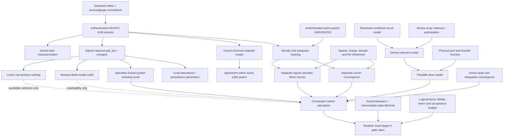

# Scientific dependencies

An arrow means “is needed to support the stronger downstream claim,” not “has already passed.” The static ranking and algebraic conclusions are exact properties of their stored inputs; they do not need k220 to be statements about those inputs.

The apparent cycle “choose mask using k180 → agree with k180 → k180 is validated” is **invalid**. The first two operations are legitimate construction and evaluation on the same endpoint. The third inference requires new evidence.

| Conclusion | Needs k220? | Other dependencies |
|---|---|---|
| Recorded raw products, cycle identity, Lie rank, saved pulse metric | No, when explicitly about the frozen inputs | Input authenticity and correct calculation |
| General shelving conjugation / distinction between state and operator convergence | No | Mathematical assumptions and correct definitions |
| Numerical confidence beyond the old retained parent | Yes, or comparable authenticated larger-parent evidence | Tracking, signed operators; no silent threshold changes |
| Spatial convergence | k220 may stabilize the comparison, but is insufficient | More independent spatial/charge/domain checks |
| Physical array participation or physical port | No amount of k-only work resolves it | Device/EM/experimental data and circuit interpretation |
| Robust device pathway selection | k220 contributes, does not suffice | Physical model, port, error objective and actual perturbations |
| Realistic fixed-target X gate | Numerical acceptance including k220 needed before certification | All model, drive, dynamical, noise and target branches |

Algorithmically independent audits share physics inputs. The independently checked Lie theorem and alternative closure provide methodological corroboration, not independent evidence that the inherited Hamiltonian describes a particular device. Exact ledger citations: C01–C03, C07–C08, C16–C24, C28–C45.
