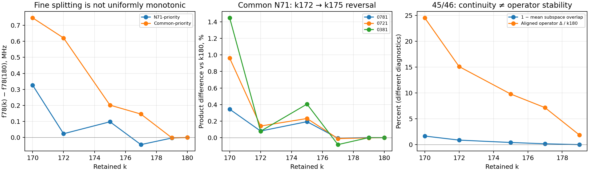

# Retained-basis re-audit — saved data only

The late **N71-priority** sequence supports low-energy static stability relative to k180. It does not establish convergence beyond k180, and it must not be substituted for the **common-priority** basis. The current common k172 is useful for cheap diagnostics, but some carrier and leakage-edge errors remain material. No production basis change is justified by this audit alone.

The adversarial checks reproduce the ambiguous 45/46 pair, find additional ambiguous clusters, expose excellent-overlap/poor-operator examples, and identify both cancellation and non-monotonic trends. **0721 has the strongest robustness across the saved selection families; all three paths are numerically mature in the late N71-priority series.** This is a static numerical conclusion, not a driven-gate or physical-model validation.

## Recovered state and coverage

The interrupted target directory did not exist. Prior inventory knowledge, the completed tracker, cached vectors/operators, and saved scalar summaries were reused. No Hamiltonian was constructed and no eigenproblem was solved.

Nine reduced N71 caches contain 48 states each, in the explicit common 180-parent × 8-oscillator basis: N71-priority k170/172/175/177/179, older asymmetric-priority k170/172/175, and energy-core k160. Native k180 caches contain 48 N71 and 11 N51 states. Saved summaries add common-priority and N71-priority selections on both grids, N51 asymmetric-priority k170–179, and historical energy/inherited-mask comparators. There are 32 distinct reduced cases and 41 family-series cases including endpoint rows.

**Missing data are not reconstructed:** reduced N51 and common-priority cases lack saved full overlap matrices, vectors, and signed operators. Their saved low-11 assignments, overlap amplitudes, energies, edge magnitudes and top-10 path ranks can be audited arithmetically, but their individual competitors and subspace/operator alignments cannot be re-audited. Their CSV cells remain blank and labels say `saved_summary_only`. Historical summary-only cases without saved ambiguity margins do not receive new identity certificates. Mock k220 results and different-model checkpoints are excluded.

Primary provenance: [tracking toolkit](../subspace_tracking/tracking.py), [authenticated cache provenance](../subspace_tracking/provenance.json), [retained selections](../n71_retained_subspace_postprocess.json), checkpoint analysis and the two authenticated N51 audit summaries listed in `summary.json`. The selection file explicitly records **oracle-informed selection against k180**; agreement with that endpoint is not an independent out-of-parent test.

## Method and interpretation

The validated Hungarian, competition clustering, principal-angle and Procrustes functions are reused unchanged. A local SVD-only symmetric Gram-whitening adapter replaces its small Gram eigendecomposition; eigensolver entry points raise an exception. Production and original toolkit files are untouched.

For normalized columns, S=U†V, P=|S|²; Hungarian maximizes the total assigned P. Both best alternatives excluding the assigned row/column edge are reported. State table direction is **retained case → k180**; positive `energy_displacement_MHz` there means endpoint minus case excitation. Low-energy/edge/path tables use **case minus endpoint**, with edge/product relative errors divided by the endpoint magnitude. Global energy offsets are removed for excitation comparisons; absolute energies and shifts are also retained.

For orthonormal frames, σ(S)=cos θ, mean overlap=Σσ²/r, projector Frobenius distance=√(2Σsin²θ), operator distance=max sin θ. If S=LΣR†, W=RL† aligns the endpoint to the case. Rectangular blocks compare A with W_left† B W_right, using separate source/target alignments and consistent Gram transforms. All actual before/after matrices and rotations are in `operator_blocks.json`. Collective alignment permits within-subspace mixing and **does not certify individual edges**. Separately, low-energy signed entries use only individual phase alignment. Null blocks below Frobenius 1e−8 have no relative convergence verdict.

Identity warning gates are P<0.81, amplitude row margin<0.25, or row/column competitor probability ≥0.25 times the assignment. Clusters failing minimum-direction P≥0.81 require more states/a finer step. These are identity gates, not convergence tolerances. Nonambiguous states are called clean at overlap **amplitude** ≥0.999 and borderline below it; a separate accuracy band distinguishes 0.995–0.999 from <0.995. Index exchanges alone are not proof of ambiguity.

For descriptive accuracy only, the [frozen k220 criteria](../k220_preregistered_criteria.json) supply strict yardsticks: 1 MHz ordinary carriers, 0.5 MHz f78, 3% edges, 5% products; practical yardsticks are 5 MHz, 1 MHz, 5%, 10%. Applying these to k180 here does **not** execute or alter the preregistered k220 acceptance test. Block 3%/5% bands are descriptive extensions, not frozen operator-block acceptance criteria. Near-zero edges are excluded from material-error examples; those examples require endpoint magnitude ≥0.01.

## Global tracking and ambiguous clusters

| N71 selection | k | Clean / borderline / ambiguous states | Index exchanges |
| --- | --- | --- | --- |
| N71_priority | 170 | 28 / 18 / 2 | [45, 46] |
| N71_priority | 172 | 30 / 16 / 2 | [] |
| N71_priority | 175 | 39 / 9 / 0 | [] |
| N71_priority | 177 | 47 / 1 / 0 | [] |
| N71_priority | 179 | 48 / 0 / 0 | [] |
| asymmetric_priority | 170 | 10 / 29 / 9 | [32, 33, 36, 37] |
| asymmetric_priority | 172 | 10 / 31 / 7 | [32, 33, 36, 37] |
| asymmetric_priority | 175 | 16 / 30 / 2 | [32, 33] |
| energy | 160 | 7 / 32 / 9 | [32, 33] |

There are 15 automatically proposed clusters across the nine cases. Additional watch blocks follow 45/46, 7/8 and low11 even after identity ambiguity disappears. All 432 reduced cached states and 59 endpoint self-check states are covered; another 253 state rows explicitly retain summary-only provenance. Full competitors, margins, exchanges and energies are in [state_tracking.csv](state_tracking.csv).

Older asymmetric selections reveal clusters {29,31}, {30,33,34}→{30,32,34}, {35,37}→{35,36}, and {45,46}; k175 retains {30,33}→{30,32}. Core160 also has unresolved singletons 35 and 36 requiring expansion. Their low11 coupling-block differences span approximately 6.8–53.4% relative to k180. No non-negligible automatic-cluster block tested here passes the descriptive 3% aligned-operator threshold; numerically null internal blocks do not provide affirmative convergence evidence.

The N71-priority k170→k172 adjacent assignment keeps 45→45 and 46→46 (P=0.9920 and 0.9790), yet the two mappings through k180 disagree. These are the only two adjacent assignment-cycle inconsistencies found. They reinforce joint tracking of the pair rather than choosing a unique physical identity by rank. All other tested adjacent compositions are consistent. [Adjacent tracking](adjacent_state_tracking.csv) includes final steps to k180.

### Real 45/46 pair

| k | Mean overlap | σmin | Centroid ΔMHz | Aligned block Δ / case | Δ / k180 |
| --- | --- | --- | --- | --- | --- |
| 170 | 0.983312 | 0.989243 | 53.899 | 22.124% | 24.550% |
| 172 | 0.991162 | 0.992497 | 28.632 | 14.362% | 15.121% |
| 175 | 0.995754 | 0.996243 | 14.710 | 9.468% | 9.808% |
| 177 | 0.998285 | 0.998377 | 4.517 | 6.951% | 7.169% |
| 179 | 0.999878 | 0.999878 | 1.181 | 1.868% | 1.880% |

At k170, σ=[0.993992925,0.989243350], θ=[6.283286°,8.411360°], projector distances are 0.258362769 (Frobenius) and 0.146279169 (operator). Individual assigned probabilities are 0.539224 and 0.546129.

For the pair→low11 grid_phi block, singular values change from [0.383841366,0.088591602] to [0.351335526,0.050953330]; Frobenius norms 0.393932311→0.355011118 and operator norms 0.383841366→0.351335526. Aligned changes are 0.087154326 Frobenius and 0.085329051 operator. Thus the previously quoted **22.124%** uses the k170 norm; the identical change is **24.550%** using k180. The nearly zero internal pair block is not the source of this 22.1% result.

At k177 the mean subspace overlap is already 0.998285 but the low11 block still differs by 7.169% of the endpoint norm. Even though k179 clears the state accuracy gate for all 48 saved states, this block differs by 1.880%. Successive pair-block differences (normalized to each later step) are 16.46%, 5.73%, 5.55%, 5.70%, 1.88%: operator approach is not uniformly shrinking. See [ambiguous_clusters.csv](ambiguous_clusters.csv), [operator_convergence.csv](operator_convergence.csv) and [adjacent_operator_blocks.csv](adjacent_operator_blocks.csv).

## Low-energy energies, states and operators

| Selection | k | Max low-11 excitation ΔMHz | f78 ΔMHz | 0781 product Δ | 0721 product Δ | 0381 product Δ |
| --- | --- | --- | --- | --- | --- | --- |
| N71 N71_priority | 172 | 1.1344 | +0.0236 | -0.0999% | -0.0883% | -0.2232% |
| N71 N71_priority | 177 | 0.2554 | -0.0443 | +0.0015% | -0.0388% | -0.0190% |
| N71 N71_priority | 179 | 0.0354 | -0.0032 | +0.0014% | +0.0002% | -0.0034% |
| N71 common_priority | 172 | 2.1572 | +0.6210 | +0.0807% | +0.1410% | +0.0783% |
| N71 common_priority | 177 | 0.8097 | +0.1463 | -0.0058% | -0.0106% | -0.0832% |
| N71 common_priority | 179 | 0.2864 | -0.0017 | +0.0016% | -0.0015% | +0.0012% |
| N51 common_priority | 172 | 4.9306 | +0.5013 | -0.6756% | -0.8574% | -1.4215% |
| N51 common_priority | 177 | 1.5008 | +0.4606 | -0.3317% | -0.2427% | -0.7018% |
| N51 common_priority | 179 | 0.7373 | +0.1269 | -0.0858% | -0.0556% | -0.2040% |
| N51 asymmetric_priority | 172 | 1.8974 | +0.4805 | -0.2086% | -0.2029% | -0.5290% |
| N51 asymmetric_priority | 177 | 0.3602 | -0.0515 | -0.0566% | -0.0197% | -0.0549% |
| N51 asymmetric_priority | 179 | 0.0500 | -0.0025 | +0.0002% | +0.0001% | +0.0009% |

All reaudited N71 low-11 labels are individually distinguishable, including 7/8; this includes numerically inaccurate older selections. For N71-priority k170, P7=0.999966476 and P8=0.999951361. At k179 they are 0.999999449 and 0.999999436; row competitors are 9.78e−10 and 9.00e−10, column competitors 9.16e−10 and 5.12e−10. There is no low-energy index exchange. Summary-only cases support only the saved tracking evidence, not newly verified competitors.

For N71-priority k177/k179, the largest low-11 excitation shifts are 0.2554/0.0354 MHz; the aligned whole-low11 operator differences are 0.02289%/0.00745%. This is strong relative-endpoint evidence. It does not extend to all high-state couplings. All individual low11 energies, f01/f07/f08/f78 and other target carriers, edges, and signed aligned entries where available are tabulated.

Concrete state/energy/operator counterexamples:

- N71 older asymmetric k172: logical-state amplitudes exceed 0.9998 and f01 moves only 0.154575 MHz, but |grid_phi_01| moves **4.707%**.
- In that same case, |grid_phi_14| moves **27.925%**, despite both state amplitudes exceeding 0.99978. Good state overlap is not an operator error bar.
- N51 common k172, saved scalar evidence: states 8/10 have minimum amplitude 0.999926, their transition changes −0.795372 MHz, but |grid_phi_8,10| changes **−5.190%**.
- Ambiguous 45/46 gives high subspace continuity with an unstable external coupling operator. We found no meaningful example of an automatic ambiguous cluster whose tested nonzero blocks were all stable at 3%; absence of such an example is not a theorem.

The summary records all 78 material-edge counterexample rows satisfying excellent overlap or sub-MHz transition change. They are examples across selections, not independent replicated experiments.

## Pathways: separate state, energy, edge and product evidence

Late N71-priority k179 differences versus k180:

| Path | Static rank | Max carrier ΔMHz | Max edge Δ | Product Δ |
| --- | --- | --- | --- | --- |
| [0, 7, 8, 1] | 1 | 0.019741 | 0.00292% | +0.00144% |
| [0, 7, 2, 1] | 3 | 0.030344 | 0.01016% | +0.00024% |
| [0, 3, 8, 1] | 4 | 0.030196 | 0.01133% | -0.00339% |

All three intermediate-state sets are individually trackable in the vector-backed N71 cases. Their late target carriers and edges satisfy the strict descriptive tolerances. The primary is global static product rank 1, 0721 rank 3 and 0381 normally rank 4. Target ordering 0781>0721>0381 persists throughout the included cases. A full-rank exception is **N51 with the N71-priority k175 mask: 0381 drops to rank 5**, then recovers at k177. Summary ranks are only reported for paths explicitly present in the saved sorted top-10; vector-backed ranks enumerate 72 simple 0→a→b→1 paths with distinct a,b∈2…10. Products are |Φ0a Φab Φb1|, without denominators or driven interference; they are not effective rates.

**0721 is the strongest cross-selection robustness comparator:** at N71 older asymmetric k172 its product error is 6.56%, versus 27.87% for 0781 and 11.63% for 0381. That advantage concerns adverse retained-mask sensitivity. In the best late N71-priority series all three are already precise; 0781 has the smallest maximum edge error at k179, while 0721's tiny product error is partly cancellation. 0381 is generally less mature than 0721 across the common/N51 summaries and has the noted rank exception. No single product statistic ranks all notions of maturity.

Cancellation is explicit: N71-priority k175 primary edge errors are +0.01393%, −0.02811%, +0.01314%, but the product error is only −0.001048%. At k179 the 0721 edge errors are +0.00202%, −0.01016%, +0.00838%, yielding +0.000242% product error. These edges are themselves small-error, so cancellation does not invalidate late stability; it invalidates treating the product error as a bound on each edge. See [pathway_convergence.csv](pathway_convergence.csv).

## Trends and apparent plateaus

[convergence_trends.csv](convergence_trends.csv) gives every saved adjacent increment, endpoint difference, increment per added retained state, direction reversals and late-step tests. No infinite-k extrapolation is made. A descriptive late plateau means the k177/179/180 range fits the stated strict tolerance; this is not evidence of an asymptotic limit.

- N71-priority f78 errors in MHz: +0.326636, +0.023614, +0.098104, −0.044302, −0.003203, 0. This is a non-monotonic approach. The final increments shrink from 0.041099 to 0.003203 MHz.
- Common N71 primary product errors: +0.3439%, +0.0807%, +0.1936%, −0.0058%, +0.0016%, 0. All three target products worsen from k172 to k175 before improving. Nested retained spaces do not imply monotonic excitation gaps or operators.
- N71-priority primary product: the k177→179 change is only 4.05e−6, but the final k179→180 change is 5.62e−5, approximately 13.9 times larger. The absolute changes are tiny, yet the earlier near-flat step is not a convergence certificate.
- N51 common maximum excitation error increases from 4.9046 to 4.9306 MHz at k170→172. Its f78 error stays around 0.45–0.50 MHz through k177 before falling to 0.1269 MHz at k179: a modest early plateau can conceal a later change.
- Moving the N71-priority mask to N51 produces an abrupt k170→172 improvement: maximum low-energy error 111.38→11.40 MHz. It remains 9.09 MHz at k177 before falling to 1.00 MHz at k179. This is mask sensitivity, not a universal k-convergence law.

## Common k172 and N51/N71

Common k172 reproduces all three target products within 0.141% on N71 and 1.422% on N51, with target-edge errors ≤0.111% and ≤0.881%. All nine target/diagnostic carriers meet the practical descriptive limits, but several exceed the strict limits: f07/f08 errors are 1.508/2.129 MHz on N71 and 4.429/4.931 MHz on N51; f78 errors are 0.621/0.501 MHz. The N51 |grid_phi_8,10| leakage edge exceeds 5%. It is therefore suitable for cheap screening and exploratory sensitivity studies, **not a precision calibration or a sole leakage/control validation basis**. For precision-sensitive exploratory control use the already saved k180 signed data and compare masks; this does not authorize a new solve or a production edit.

Common k177 improves all N71 target carriers to strict tolerance, but N51 still has carrier errors up to 1.501 MHz. Common k179 passes these target tolerances on both grids; its maximum low-11 excitation difference is 0.286/0.737 MHz. This supports using larger saved cases as sensitivity comparators, not automatically changing the production common k172. N71-priority k172 is not a universal substitute: on N51 its maximum excitation error is 11.396 MHz and f78 error 3.455 MHz, worse than common k172.

Spatial refinement has no uniform sign: common k172 maximum excitation error is smaller at N71, but its f78 error is larger; some leakage edges improve. N51-tuned asymmetric k179 has maximum excitation error 0.0500 MHz, whereas transplanting its masks to N71 at lower k has substantial operator problems. The relevant comparison is a grid plus its explicit mask, not k alone. Saved cross-spatial tracking gives P7=0.999185588 and P8=0.998135829, with no ambiguity in low11. These are existing interpolation-aware results, not a new spatial comparison. No saved reduced N51 high-state vectors exist, so whether its high-state ambiguous clusters match N71 cannot be answered.

## Safe conclusions and the exact role of k220

Safe now: low-energy N71 identities including 7/8; static primary-product dominance; late N71-priority target energy/edge stability **relative to k180**; robustness value of the 0721 comparator; and the need to evaluate operators independently of states. Carry all statements with their mask, grid, operator and tolerance.

Weaken or withdraw any blanket claim that all 48 states are converged at k172, that common k172 inherits N71-priority accuracy, that excellent overlap or a tiny path-product change certifies couplings, or that k-step improvement is uniformly monotonic. The pair 45/46, older clusters around 29–37, weak logical/leakage edges 1–4, 0–5, 0–10, 8–10, and the fine 7–8 carrier/operator remain particularly informative k220 diagnostics. N71-priority k179's favorable endpoint comparison does not bound their response to newly included parent modes.

The pending authenticated **same-parent k180/200/220** series must apply the frozen criteria to both 180→220 and 200→220, retain tracking/cluster tests, and compare the same signed blocks. A >1 MHz ordinary-carrier or >0.5 MHz f78 difference, >3% target-edge difference, >5% product difference, amplitude <0.999 or a rank change would remove strict confidence. Practical confidence is lost beyond 5 MHz/1 MHz, 5% edges, 10% products or amplitude <0.995; identity ambiguity suspends state-specific pathway claims. Frozen borderline/fail bands still govern the formal result. An altered primary rank or material 7/8/logical operator change would reopen pathway selection; a comparator rank exchange would weaken ordering confidence. High-state cluster instability alone would chiefly reopen leakage/model-reduction claims, not automatically erase independently stable low-energy results.

If both comparisons pass and increments/operator diagnostics support stability, that strengthens retained-space confidence and permits reconsidering the basis for the chosen observable. It still establishes neither absolute spatial convergence nor completeness with respect to the omitted distributed-array mode, and validates no gate. No result in this audit supplies an error bound on those omissions.

## Reproduction and verification

Run `reaudit.py`, `python -m unittest discover -s research/sandbox/k_convergence_reaudit -p 'test_*.py' -v`, then `finalize.py`, with `PYTHONDONTWRITEBYTECODE=1 OPENBLAS_NUM_THREADS=1 OMP_NUM_THREADS=1`. Use the existing NumPy/SciPy environment (`/opt/anaconda3/bin/python` here). All scripts/results and plotting caches stay in this directory. The old reconstruction driver and old synthetic eigensolve tests are intentionally not executed.

**12/12 sandbox checks PASS:** authentication and preservation; no-eigensolve tripwires; complex SVD whitening, principal angles and rectangular alignment; real 45/46 regression; all cached-state coverage; honest missing-data fields; pathway products/cancellation; adjacent assignment cycles; distinct masks. Input SHA-256s, counterexamples, coverage and scientific verdict are in [summary.json](summary.json); actual test output is [tests.log](tests.log). [verification.json](verification.json) confirms all original tracked-file bytes, staged/unstaged diffs, cached checkpoints and prior tracking files are unchanged. The three pre-existing modified production paths were preserved. No commit or push.
